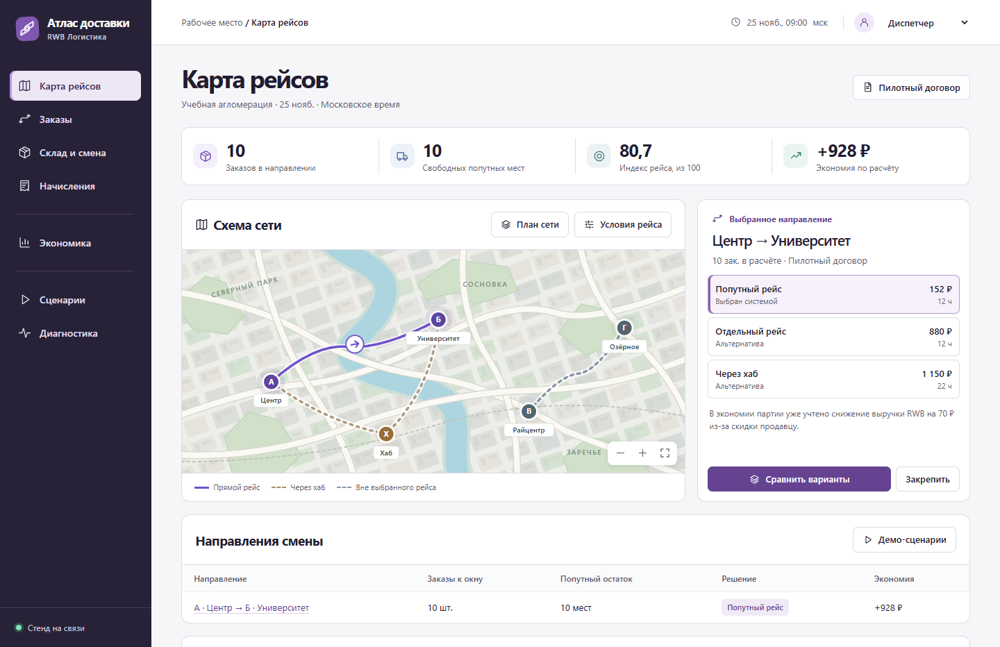

# Атлас доставки между ПВЗ

Локальный диспетчерский стенд для хакатона RWB, трек ПРО. Продавец размещает партию ходового товара в одном пункте выдачи, покупатель забирает заказ в выбранном ПВЗ. Диспетчер сравнивает попутный заезд, отдельный рейс и доставку через хаб по стоимости, свободному месту и обещанному сроку.

**[Скачать для Windows x64](https://github.com/panikuuu/atlas-pvz/releases/latest)** · **[Презентация для жюри](docs/presentation.pdf)** · **[Контракт API](app/openapi.json)** · **[План масштабирования](docs/operations.md)**



## Запуск за минуту

**Windows 10/11 x64.** Скачайте ZIP из Releases, распакуйте его в обычную папку и дважды нажмите **Atlas-PVZ.exe**. Карта откроется в браузере. В окне программы появится локальный адрес. Оставьте это окно открытым до конца демонстрации. Для остановки нажмите Ctrl+C. База сохраняется в папке `data` рядом с EXE. Для переноса смены закройте приложение и скопируйте папку целиком. Python и доступ в интернет для запуска не требуются.

**Docker.** В каталоге репозитория, с запущенным Docker и Compose:

```sh
docker compose up --build -d --wait
```

Откройте **http://127.0.0.1:8080**. Проверка готовности — `/health/ready`. Логи — `docker compose logs -f atlas`. Остановка — `docker compose down`. Именованный том сохраняет смену между запусками. Если порт занят, задайте переменную `ATLAS_PORT` перед запуском. Для первой сборки Docker потребуется интернет.

**Из рабочего дерева.** При наличии CPython 3.15.1 выполните `python app/serve.py`. Интерфейс доступен на том же адресе. Чтобы использовать отдельную базу, задайте `PVZ_DATA` с путём к каталогу. Windows-сборку из содержимого репозитория создаёт `python scripts/build_windows.py`. Готовые EXE, ZIP и контрольные суммы появятся в `dist/`.

## Что показать экспертам

1. **Карта рейсов.** Выберите направление и сравните стоимость партии и причины выбора. У обратной стрелки собственный поток, окно и загрузка.
2. **Экономика.** Выберите пилотный договор, нейтральный сценарий и 0% добровольного ожидания. Сравните полные расходы схем на одних и тех же заказах.
3. **Сценарии → Частичный сбой.** Начните на демонстрационной смене. Пройдите шаги, откройте заказ и журнал начислений. Повторное событие не должно повторно начислять деньги. Начало сценария заменяет текущую демонстрационную смену.
4. **Меню ролей справа вверху.** Переключитесь между диспетчером, сотрудником ПВЗ и продавцом. Посмотрите остатки, статусы заказов и начисления глазами участника.

## На каких допущениях держится экономика

Все данные, ставки и расписания демонстрационные. Одна синтетическая неделя из 198 заказов повторяется четырежды. В нейтральном варианте модель сравнивает 792 заказа за 28 дней. Отдельный рейс оплачивается за полный круг, попутный — за крюк, остановку и обработку. Учитываются объём, масса, рабочее окно ПВЗ, непроданный запас, возвраты и сбои. Цена доставки покупателю одинакова.

| Пилотный договор, 28 дней | Пессимистичный | Нейтральный | Оптимистичный |
| --- | ---: | ---: | ---: |
| Заказов | 568 | 792 | 1 016 |
| Напрямую | 260 | 500 | 672 |
| Изменение результата RWB после координации | −14 154 ₽ | +1 531 ₽ | +14 494 ₽ |

В нейтральном пилоте продавец платит 85 ₽ за прямую доставку и 92 ₽ через хаб. Сборка стоит 12 ₽. Экономия на операциях 6 302,82 ₽, изменение тарифного дохода −571,36 ₽, координация 4 200 ₽. Остаётся **1 531,46 ₽** до разовых 38 000 ₽ на запуск. При прежней загрузке запас прочности — около 3,06 ₽ на прямой заказ. На пилоте нужны счета за действительно устранимые операции, фактическая загрузка машин и время сотрудников.

В пошаговых кейсах используется исходный договор. В кейсе долгого хранения задано 30 суток. Карточка отдельного рейса оценивает будущие затраты для уже размещённого груза. Портфельный результат дополнительно учитывает размещение и общие расходы. Денежные значения API передаются в копейках.

## Проверка кейсов

```sh
python tests/test_cases.py
```

Для этой команды нужен CPython 3.15.1. Готовый EXE проверяется командой `python tests/test_cases.py --exe dist/Atlas-PVZ.exe` из обычного Python для Windows. Каждый прогон поднимает собственный сервер с временной базой.

| Кейс | Что проверяет тест |
| --- | --- |
| Городская партия | 10 заказов едут попутно и выданы |
| Единичный заказ | 1 заказ идёт через хаб и выдан |
| Возврат | 9 заказов выданы, 1 единица вернулась на полку |
| Сбой логистики | Все 10 выданы после восстановления. Повтор не добавил движений и начислений, изменённое тело с тем же ключом получило 409 |
| Долгое хранение | Сработало уведомление о сроке, единица передана хабу, место на полке освобождено |
| Село | 2 заказа отправлены попутно и выданы |

Во всех шести кейсах проверяются расхождения остатков и начислений. Отдельная проверка охватывает готовность HTTP-сервера и запрет запуска диспетчерских операций для ролей продавца и ПВЗ.

## Устройство и история кода

Браузерный клиент на HTML, CSS и JavaScript обращается к локальному HTTP API. Сервер CPython ведёт SQLite-базу. Маршрутизация, заказы, движения товара, идемпотентные команды и начисления используют сервер из предоставленной командой сборки.

| Каталог | Содержимое |
| --- | --- |
| `app/static/`, `app/fixtures/` | Редактируемые исходники интерфейса и синтетическая сеть |
| `app/openapi.json`, `app/serve.py` | Контракт API и исходный код серверной точки входа для Docker |
| `app/*.pyc` | Семь модулей исходного сервера в формате байткода CPython 3.15.1 |
| `vendor/windows/` | Первоначальный EXE, инструкция команды и лицензии поставки |
| `scripts/`, `tests/`, `.github/workflows/` | Сборка Windows, сквозные проверки и CI |

Первый коммит фиксирует переданный ZIP и его компоненты. В поставке были JavaScript, CSS, HTML, fixture, OpenAPI и скомпилированные модули сервера. Авторские Python-файлы этих семи модулей в ZIP отсутствовали. Последующие коммиты отражают реальные изменения после импорта.
