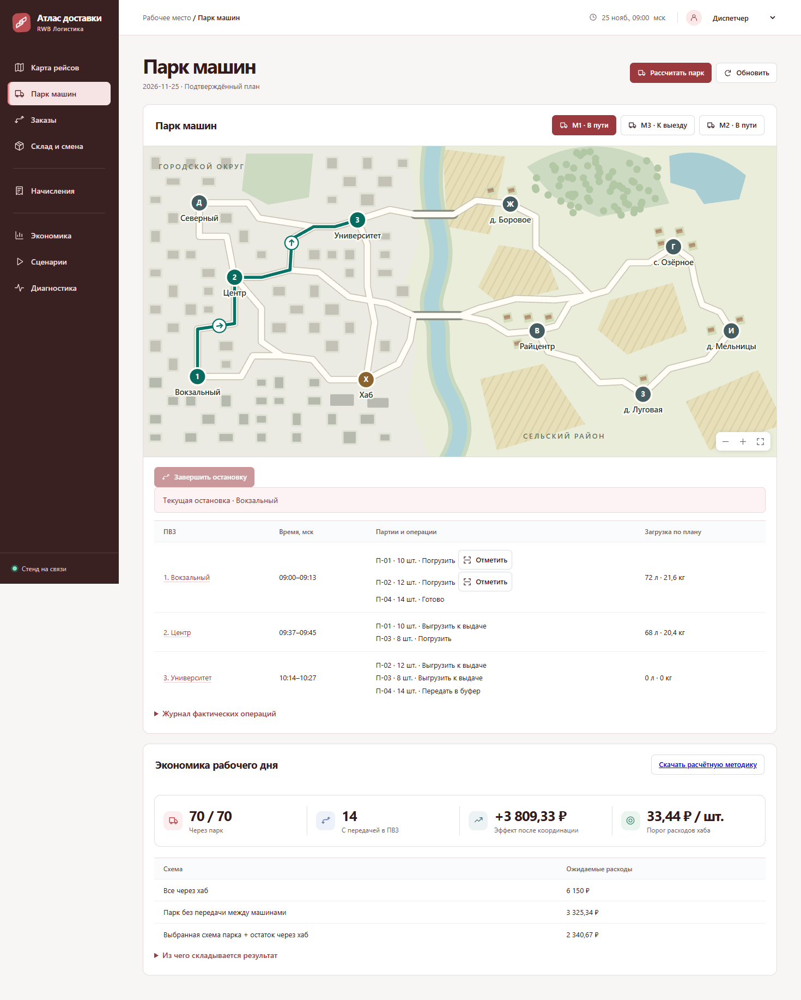

# Рабочий день с несколькими машинами

## От расчёта к выполнению

1. Откройте **«Парк машин»**, нажмите **«Рассчитать парк»** и выберите рабочий день. Для рабочих заказов выберите **«Собранные заказы смены»**.
2. Для каждой машины задайте начало, конец, время выезда, предельное время завершения и свободную вместимость. Тип **«Уже в расписании»** означает, что по базовому коридору машина едет и без новых заказов. Если под заказы машину нужно вывести отдельно, выберите **«Дополнительная машина»**. В одном расчёте доступно до шести машин.
3. Раскройте **«Топливо, ставки и сравнение с хабом»**, чтобы при необходимости изменить исходные параметры. Нажмите **«Рассчитать парк»**. Переключайте машины и остановки над картой. Ниже видны партии, время, объём после остановки и эффект относительно хаба.
4. Нажмите **«Подтвердить план»**. Для каждой машины нажмите **«Начать рейс»**. На текущей остановке используйте **«Отметить»** только после передачи всей указанной партии. После последней операции на точке выберите **«Завершить остановку»**. Для параллельной работы переключайтесь между машинами. Состояние сохраняется при перезапуске.
5. Заказы ручной смены объединяются в партии до пяти единиц на направлении. Номера исходных заказов видны в маршрутном листе. Во время передачи груз виден в **«Буфере передачи»**. Отметка «Выгрузить к выдаче» меняет рабочие заказы на «Готов к выдаче».

## Будний день. Передача между двумя машинами

Оставьте настройки буднего дня и разрешите передачу через ПВЗ. Три машины обслуживают 70 посылок. Партия **П-04** из 14 посылок едет из Вокзального в Мельницы.

- На **М1** отметьте погрузку П-04 на Вокзальном. На остановке в Университете отметьте **«Передать в буфер»**. Товар останется в Университете под транзитной отметкой.
- На **М2** в Университете появится доступная операция **«Забрать из буфера»**. Забор возможен после отметки приёмки с учётом операционного интервала. На конечной точке отметьте выгрузку к выдаче.
- **М3** одновременно развозит партии на сельском направлении. Можно выполнить её операции между визитами М1 и М2.

В журнале П-04 видны четыре отдельных события и машины на обеих частях пути. При выключенной передаче Атлас рассчитывает доступные прямые маршруты и хаб для того же потока.

## Вся сеть. Результат каждого ПВЗ

Выберите **«Вся сеть · девять ПВЗ»** и нажмите **«Рассчитать парк»**. В расчёте четыре машины и девять точек с операциями. Под итогом дня раскрывается разбивка по ПВЗ. Первая таблица относится к пунктам выдачи и показывает, как складывается результат RWB. В разделе **«Работа и экономика партнёров»** видны погрузка, выгрузка, передача, труд и маржа каждой точки, включая ПВЗ, которые в этот день только отправляли заказы.

## Пиковый день. Остаток через хаб

Выберите **«Пиковый день»** и сохраните исходные ставки. В калькуляции видно 144 посылки, из которых 137 забирает парк, а 7 остаются на хабе. Дополнительную машину система оставляет без заказов, если её выезд увеличивает суммарные расходы. Измените свободные литры любой машины и пересчитайте, чтобы увидеть, как изменилась загрузка и число посылок на хабе.

## Малый поток. Сохранение базовой схемы

Выберите **«Малый поток»**. Покажется расчёт потери при запуске парка. Система оставит партии на хабе, кнопка подтверждения парка будет недоступна. Такой же вывод можно получить в буднем сценарии при снижении устранимых расходов хаба.

## Партия ещё не принята в ПВЗ

Если вторая машина уже выбрана, а первая ещё не передала груз, маршрутный лист показывает **«Ждёт передачи»**. Переключитесь на первую машину и выполните фактическую погрузку и сдачу партии. Если ПВЗ закрылся, а план подтверждён, учитывайте текущее место партии и фактическое время. Сценарии задержки и повторного заезда одной машины доступны в [маршрутном листе одного рейса](truck-guide.md).

Скорость, расписания и партии тестовых дней моделируются. Фактическую стоимость и наличие места для передачи подтверждают по данным перевозчика и ПВЗ. [Экономика и формулы](../app/static/economics.md)
